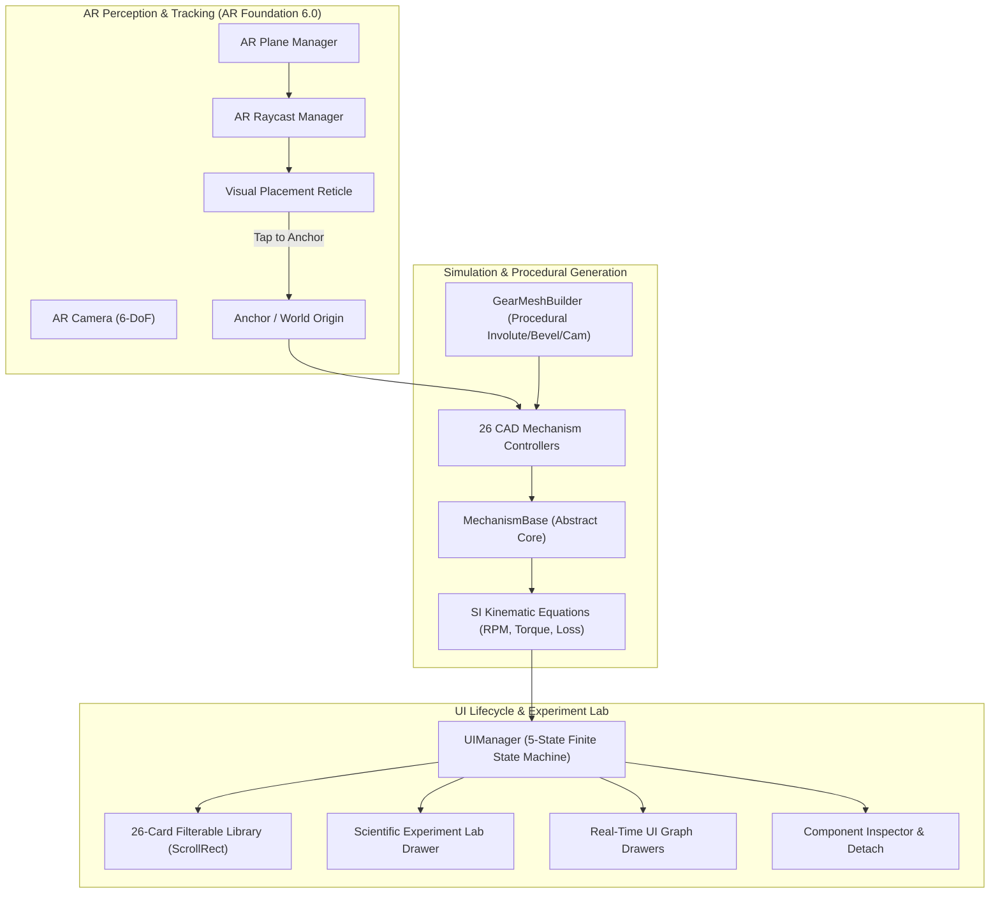
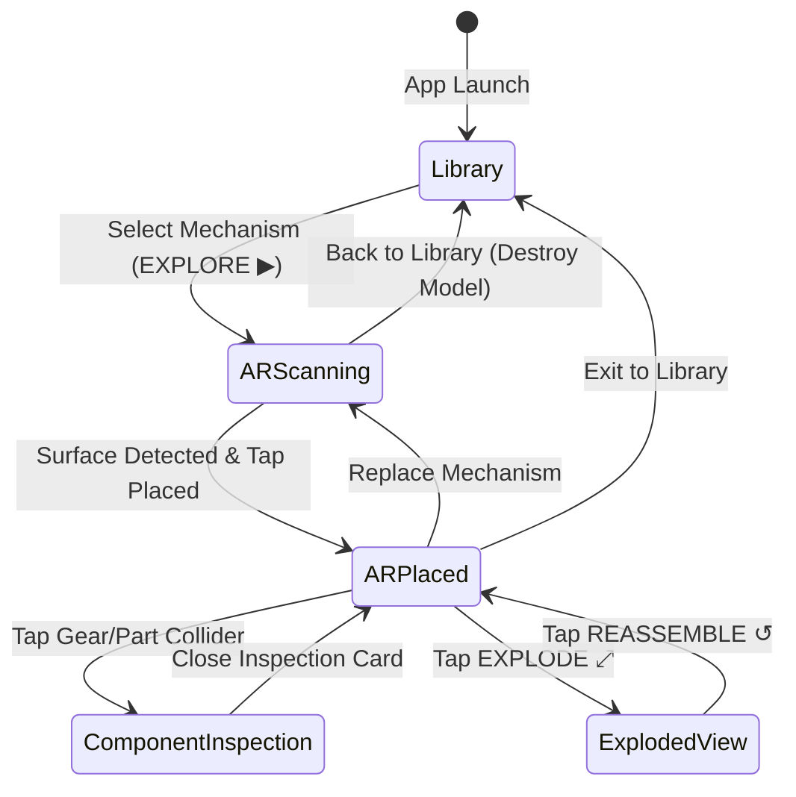

# MECH-XR — SYSTEM DESIGN & ARCHITECTURE SPECIFICATION

**Project:** MECH-XR — Interactive Mechanical Engineering Laboratory in Augmented Reality  
**Target Platform:** Android (Google ARCore)  
**Development Engine:** Unity 6.3 LTS (`6000.3.27f2`)  
**Package ID:** `com.mechxr.gearlearning`  
**Architecture:** 64-bit ARM (`arm64-v8a`)  

---

## 1. SYSTEM OVERVIEW

MECH-XR is designed around three decoupled core architectural layers:
1. **Perception & Tracking Layer (AR Foundation & ARCore)**: Surface detection, point-cloud feature tracking, raycast hit testing, and 6-DoF world anchor management.
2. **Kinematic & Procedural CAD Simulation Layer**: Pure algorithmic mesh synthesis via `GearMeshBuilder.cs` and SI-compliant kinematic drivers (`MechanismBase.cs`).
3. **Interactive UI & Analytical State Layer**: Unified finite state machine (`UIManager.cs`) orchestrating library browsing, component inspection, exploded views, and the Scientific Experiment Lab.

---

## 2. FINITE STATE MACHINE (UI LIFECYCLE)

To avoid UI panel collisions, ghost touches, or overlapping screens on mobile devices, `UIManager.cs` implements an explicit 5-state lifecycle:

### State Specifications:
1. **`Library`**: Catalog browser displaying 26 mechanism cards grouped into 4 categories (`ALL`, `GEARS`, `ENGINES`, `LINKAGES`, `DRIVES`). Fixed top header, fixed category bar, dynamic vertical `ScrollRect` ($4398\text{ px}$ height).
2. **`ARScanning`**: Prompts the user to pan camera over horizontal surfaces; visualizes tracking reticle; deactivates catalog and experiment docks.
3. **`ARPlaced`**: Instantiates procedural mechanism root at anchor position; displays bottom dock (Speed slider, Pause, Reverse, Presets) and top `EXPERIMENT LAB` toggle.
4. **`ComponentInspection`**: Activated upon raycast hit on any `InspectableComponent`. Smoothly flies component forward along explosion axis, exposes material specs, load rating, and dimensional callouts.
5. **`ExplodedView`**: Triggers multi-part explosion vectors simultaneously outward from assembly center, allowing students to observe internal shafts, bearings, and conjugate gear teeth.

---

## 3. PROCEDURAL CAD MESH GENERATION PIPELINE

MECH-XR avoids binary asset bloat and proprietary 3D CAD licensing by generating every gear tooth, bevel angle, helical flute, camshaft profile, and engine piston directly at runtime using pure trigonometric algorithms in `GearMeshBuilder.cs`:

| Mechanism Geometry | Algorithmic Formulation | Mesh Characteristics |
|:---|:---|:---|
| **Spur & Planetary Involute Gears** | Standard Euler-Savary involute curves: $x = r_b(\cos\theta + \theta\sin\theta)$, $y = r_b(\sin\theta - \theta\cos\theta)$ | 20° pressure angle, dedendum/addendum fillets, central bore, weight-relief cutouts |
| **Bevel Gears** | Spherical involute pitch cones intersecting at 90°: $R_{\text{pitch}} = m \cdot Z / 2$, pitch cone angle $\delta = \arctan(Z_1/Z_2)$ | Tapered tooth faces converging at pitch apex |
| **Worm & Throated Wheel** | Helical Acme profile: axial lead $L = \pi \cdot m \cdot z_1$, conjugate circular throating radius | Single-start thread, concave hourglass rim |
| **Helical & Herringbone Gears** | Continuous helical extrusion with twist angle $\beta = \pm 20^\circ$; herringbone pairs mirrored with central apex | Opposing tooth helices canceling axial thrust forces |
| **Cam Profiles** | Harmonic rise ($s = \frac{h}{2}(1 - \cos\pi\theta)$), constant dwell, harmonic fall | Continuous curvature preventing follower binding |
| **Linkages & Levers** | Capsule-extruded structural linkage bars with dual cylindrical pin bores | Rounded ends with bearing collars |

---

## 4. MOBILE RENDERING & BATTERY OPTIMIZATION

- **Forward Rendering Pipeline**: Built-in Unity pipeline with mobile diffuse/metallic specular shaders.
- **Dynamic Batching & Instancing**: Procedurally synthesized meshes share unified material instances grouped by metal class (Cast Iron, Hardened 52100 Steel, Phosphor Bronze, Industrial Gold).
- **Zero Asset Overhead**: The total project size remains exceptionally compact (~8 MB source Assets), allowing fast load times and minimal thermal impact on mobile processors.
- **Target Frame Rate**: Locked at 60 FPS (`Application.targetFrameRate = 60`) with vsync synchronized to the POCO X6 5G display.
