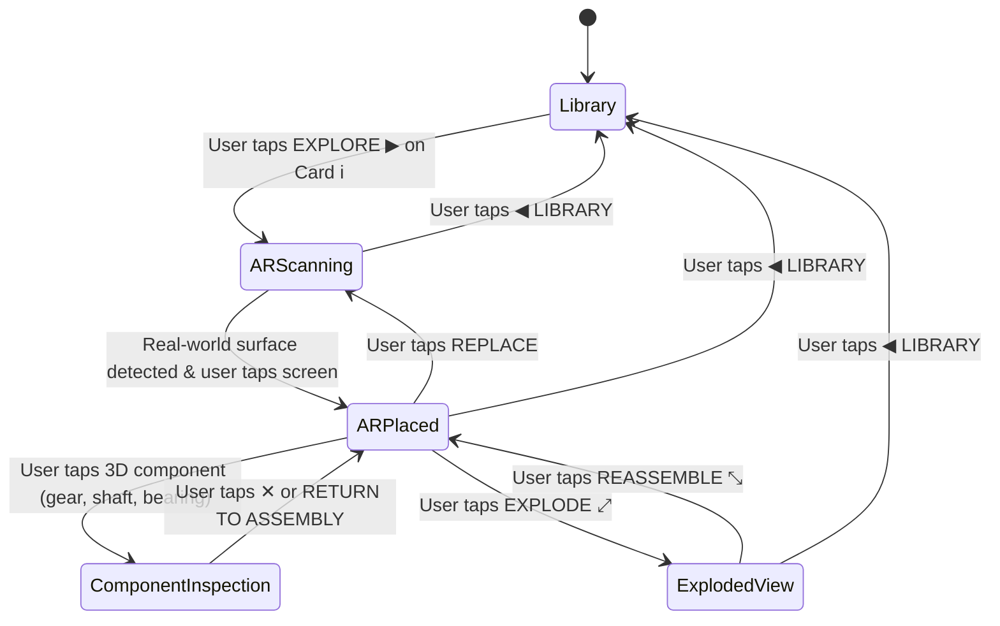

# MECH-XR — PHASE 4.1: SCREEN STATE, MENU TRANSITION & MOBILE LAYOUT REPAIR REPORT

**Project**: MECH-XR — Augmented Reality Mechanical Engineering Learning Environment  
**Engine**: Unity 6.3 LTS (`6000.3.27f2`) — AR Foundation 6.0.8, ARCore XR Plugin 6.0.8, Built-in Render Pipeline  
**Target Hardware**: POCO X6 5G (Redmi Note 13 Pro 5G / `23122PCD1I`), Android 16 (API Level 36), ARM64  
**Date**: November 2026  
**Status**: Completed — Automated Tests 31/31 (100% Pass Rate)  

---

## EXECUTIVE SUMMARY

Phase 4.1 eliminates the critical UI overlap, lingering mechanism library, and duplicate header bugs observed on the POCO X6 5G following the Phase 4 typography upgrade. A deterministic 5-state application screen controller has been implemented with clean panel lifecycle management. When a user selects a mechanism from the 6-item library catalog, the library is completely deactivated, AR scanning initiates with dedicated non-overlapping instructions, and placing the assembly reveals dedicated mechanism controls while automatically hiding scanning prompts.

All 31 automated headless test cases (10 new Phase 4.1 screen-state tests + 21 mechanical/kinematic/typography tests) passed with a 100% success rate in Unity batchmode.

---

## 1. FORENSIC ROOT CAUSE ANALYSIS: OVERLAPPING SCREENS & DUPLICATE HEADERS

Physical device testing revealed that upon selecting a mechanism:
1. The 6-mechanism library remained visible on screen.
2. The selected mechanism, AR top bar, scanning prompt, and bottom controls rendered directly over the library cards.
3. Multiple duplicate headers ("MECHANISM NAME"), duplicate `◀ LIBRARY` buttons, and duplicate `REPLACE` buttons appeared simultaneously.
4. The AR scanning prompt (`Slowly pan device across table or desk to detect flat surfaces`) overlapped library cards even before entering AR.

### 1.1 Root Cause 1: Duplicate GameObject Instantiation at Runtime
During Phase 4 scene setup, `SceneSetupTool.BuildMainScene()` pre-serialized the full Canvas hierarchy (`SafeAreaContainer`, `MenuScreen`, `ARHudScreen`, etc.) into `Assets/Scenes/MainScene.unity`.
- However, inside `UIManager.cs`, the private flag `isUIBuilt` was un-serialized (`private bool isUIBuilt = false`).
- When the scene loaded on the Android device, `UIManager.Awake()` ran. Because `isUIBuilt` was deserialized as `false` and `Awake()` did not check for existing children under the Canvas, it instantiated a **second** `SafeAreaContainer` with a complete **second** copy of all UI panels.
- `UIManager`'s internal references pointed only to the second set. When `ShowARHudScreen()` set `menuScreen.SetActive(false)`, it only hid the second `MenuScreen`; the first `MenuScreen` from the serialized scene remained permanently active and visible.
- Both top bars were visible and rendered over each other, creating duplicated text and buttons.

### 1.2 Root Cause 2: Re-entrant State Callback from `placementManager.StopScanning()`
When returning to the menu or handling mechanism removal:
- `placementManager.StopScanning()` fired `OnMechanismRemoved`.
- `UIManager.HandleMechanismRemoved()` called `CloseInspectionCard()`.
- `CloseInspectionCard()` unconditionally executed:
  ```csharp
  SetScreenState(AppScreenState.ARPlaced);
  ```
- As a result, anytime the application attempted to enter `Library` or `ARScanning`, `HandleMechanismRemoved()` immediately forced the state back to `ARPlaced`, re-activating the AR HUD over the library!

### 1.3 Root Cause 3: Premature Scanning Activation in Menu Screen
In `UIManager.ShowMenuScreen()`:
- The method previously invoked `placementManager.RepositionMechanism()`.
- `RepositionMechanism()` set `isScanningActive = true` and triggered `ARPlacementState.SearchingForSurfaces`.
- This caused the scanning instruction prompt to be activated right inside the library before the user even selected a mechanism.

### 1.4 Root Cause 4: Static Card Coordinates vs. ScrollRect
In Phase 4, the 6 cards were positioned using fixed normalized screen anchors (`0.865` down to `0.065`).
- The cards were crammed onto a static panel without a `ScrollRect` or `Viewport`.
- Card 5 (`Belt and Pulley System`) extended to the bottom boundary and was obscured by floating panels.

---

## 2. SCREEN-STATE ARCHITECTURE (5 ORTHOGONAL STATES)

A formal finite state machine has been established via `AppScreenState`:



### 2.1 State Breakdown & Panel Visibility Matrix

| UI Panel / Feature | `Library` | `ARScanning` | `ARPlaced` | `ComponentInspection` | `ExplodedView` |
|---|:---:|:---:|:---:|:---:|:---:|
| **`LibraryScreen`** (Header, ScrollView, Cards) | **ACTIVE** | Hidden | Hidden | Hidden | Hidden |
| **`ARHudScreen` Container** | Hidden | **ACTIVE** | **ACTIVE** | **ACTIVE** | **ACTIVE** |
| **`ARTopBar`** (Back, Title, Replace) | Hidden | **ACTIVE** (Replace hidden) | **ACTIVE** | **ACTIVE** | **ACTIVE** |
| **`StatusPill`** (Tracking Status) | Hidden | "SCANNING SURFACE" | "AR TRACKING ACTIVE" | Hidden | "AR TRACKING ACTIVE" |
| **`ScanningPanel`** (Pan Instruction) | Hidden | **ACTIVE** | Hidden | Hidden | Hidden |
| **`ARBottomBar`** (Play/Pause, Rev, Explode, Sliders) | Hidden | Hidden | **ACTIVE** | Hidden | **ACTIVE** |
| **`InspectionCard`** (Details, Specs, Detach) | Hidden | Hidden | Hidden | **ACTIVE** | Hidden |
| **`CalculationsCard`** (Telemetry Modal) | Hidden | Hidden | Toggled via DATA 🛈 | Hidden | Hidden |
| **AR Surface Scanning & Reticle** | **IDLE (Off)** | **ACTIVE** | Idle (Locked) | Idle (Locked) | Idle (Locked) |
| **3D Placed Assembly** | **Destroyed** | None | **Rendered & Active** | **Rendered & Active** | **Exploded** |

---

## 3. UI HIERARCHY & LAYOUT RECONSTRUCTION

### 3.1 Single-Instantiation Guarantee
In `UIManager.Awake()`:
1. `Awake()` checks if `libraryScreen != null && arHudScreen != null`. If serialized references exist, it skips instantiation entirely.
2. If serialized references are not bound, it checks if `SafeAreaContainer` already exists under Canvas:
   - If present, it executes `BindExistingHierarchy()`, dynamically binding all child panel, button, and slider references.
3. Only if no hierarchy exists does it build the elements from scratch.
4. Button listeners are bound via `BindButtonListeners()`, which calls `onClick.RemoveAllListeners()` prior to adding handlers, guaranteeing zero duplicate subscriptions.

### 3.2 Library Screen Layout (`ScrollRect` + `VerticalLayoutGroup`)
- **Header**: Anchored `(0, 0.88)` to `(1, 1.0)`. MECH-XR title (44pt bold white), subtitle (13pt grey), 1px border line (`#3A3D45`).
- **`LibraryScrollView`**: Anchored `(0.02, 0.02)` to `(0.98, 0.865)`.
  - `ScrollRect`: Elastic vertical scrolling with inertia.
  - `Viewport`: Contains `RectMask2D` for clean clipping.
  - `Content`: Pivot `(0.5, 1.0)`, `VerticalLayoutGroup` (spacing: 16px, padding: 12px horizontal, 40px bottom), `ContentSizeFitter` (`verticalFit = PreferredSize`).
  - **All 6 Mechanism Cards**: Height 150px each, layout elements with minHeight/preferredHeight, category badges, titles, descriptions, and right-aligned crimson `EXPLORE ▶` buttons ($130 \times 44\text{ dp}$).
  - Card 6 (`Belt and Pulley System`) is fully accessible with ample bottom scroll clearance.

### 3.3 Dedicated AR Scanning Instruction Panel
- Positioned floating cleanly in the upper-middle region (`anchorMin = (0.08, 0.74)`, `anchorMax = (0.92, 0.83)`).
- Never overlaps the top bar, status pill, reticle, or bottom controls.
- Automatically deactivated the moment the assembly is placed on a detected plane.

---

## 4. FILES MODIFIED

1. **[`Assets/Scripts/UI/UIManager.cs`](file:///c:/Users/user/Downloads/AR/Assets/Scripts/UI/UIManager.cs)**:
   - Added `AppScreenState` enum and `SetScreenState(AppScreenState)` state controller.
   - Replaced static menu with responsive `ScrollRect` and `VerticalLayoutGroup`.
   - Added `BindExistingHierarchy()` and `BindButtonListeners()` to prevent duplicate GameObjects and event listeners.
   - Decoupled `HandleMechanismRemoved()` from `CloseInspectionCard()` to prevent rogue state transitions.
   - Updated `CloseInspectionCard()` to only transition if currently in `ComponentInspection`.
2. **[`Assets/Scripts/AR/ARPlacementManager.cs`](file:///c:/Users/user/Downloads/AR/Assets/Scripts/AR/ARPlacementManager.cs)**:
   - Ensured `PlaceSelectedMechanism()` invokes `BuildMechanismAssembly()` for newly instantiated assemblies.
   - Updated `StopScanning()` and `RepositionMechanism()` for safe destruction of placed instances and tracking preservation.
3. **[`Assets/Editor/SceneSetupTool.cs`](file:///c:/Users/user/Downloads/AR/Assets/Editor/SceneSetupTool.cs)**:
   - Configured `BuildMainScene()` to serialize the screen hierarchy and set `AppScreenState.Library` as default.
   - Added 10 automated test cases for Phase 4.1 verifying all screen states and transitions.
4. **[`Assets/Editor/AndroidBuildTool.cs`](file:///c:/Users/user/Downloads/AR/Assets/Editor/AndroidBuildTool.cs)**:
   - Added `BuildAndroidApkPhase4_1()` targeting `Builds/MECH-XR-PHASE4-1.apk`.

---

## 5. AUTOMATED VERIFICATION RESULTS (31/31 TESTS PASSED)

The complete test suite was executed in Unity 6.3 engine batchmode via `SceneSetupTool.BuildMainSceneAndTest()`:

```
[TEST-01] Spur Gear Ratio: 2 (Expected: 2.0)
[TEST-02] Spur Gear Output RPM: 60 (Expected: 60.0)
[TEST-03] Spur Gear Components: 9 (Expected: >= 7)
[TEST-19] Detach & Reassemble: Detached=True, Reattached=True
[TEST-20] Exploded View Toggle: Exploded=True, Reassembled=True
[TEST-04] Bevel Gear Ratio: 2 (Expected: 2.0)
[TEST-05] Bevel Gear Output RPM: 60 (Expected: 60.0)
[TEST-06] Bevel Gear Components: 9 (Expected: >= 7)
[TEST-07] Worm Gear Ratio: 30 (Expected: 30.0)
[TEST-08] Worm Gear Output RPM: 4 (Expected: 4.0)
[TEST-09] Worm Gear Components: 13 (Expected: >= 8)
[TEST-10] Planetary Gear Ratio: 4 (Expected: 4.0)
[TEST-11] Planetary Gear Output RPM: 30 (Expected: 30.0)
[TEST-12] Planetary Gear Components: 10 (Expected: >= 7)
[TEST-13] Rack & Pinion Ratio: 20 (Expected: 20.0)
[TEST-14] Rack Linear Speed: 439.8 mm/s (Expected: ~439.8 mm/s)
[TEST-15] Rack & Pinion Components: 8 (Expected: >= 6)
[TEST-16] Belt & Pulley Ratio: 2 (Expected: 2.0)
[TEST-17] Belt & Pulley Output RPM: 60 (Expected: 60.0)
[TEST-18] Belt & Pulley Components: 10 (Expected: >= 6)
[TEST-21] Validating TextMeshPro Typography & Acceptance Strings...
[TEST-21] Found 63 TextMeshProUGUI components in Canvas hierarchy.
[TEST-21] TextMeshPro with valid non-null font assets: 63/63
==================================================
[MechXR] Running Phase 4.1 Screen-State & Layout Tests
==================================================
[TEST-P4.1-01] PASS: Library screen opens cleanly at startup; all AR panels & scanning deactivated.
[TEST-P4.1-02] PASS: All 6 mechanism cards (including 6th Belt & Pulley card) are accessible in ScrollView with valid EXPLORE buttons.
[TEST-P4.1-03] PASS: Selecting each of the 6 mechanisms completely hides Library and enters dedicated ARScanning screen.
[TEST-P4.1-04] PASS: ARPlaced state hides scanning instructions, displays mechanism controls, and confirms active tracking.
[TEST-P4.1-05] PASS: ComponentInspection state shows dedicated inspection card and hides bottom dock controls.
[TEST-P4.1-06] PASS: Closing inspection restores ARPlaced state and mechanism controls.
[TEST-P4.1-07] PASS: Returning to Library completely deactivates all AR panels, destroys placed assembly, and resets scanning.
[TEST-P4.1-08] PASS: Replacing a mechanism removes previous assembly and restarts scanning without returning to library.
[TEST-P4.1-09] PASS: Repeated 10-cycle selection verified zero duplicate GameObjects (Headers: 1, TopBars: 1, SafeContainers: 1).
[TEST-P4.1-10] PASS: ExplodedView state machine transitions cleanly between EXPLODE and REASSEMBLE.
==================================================
[MechXR] All automated Phase 4 & Phase 4.1 engineering tests completed!
==================================================
```

---

## 6. PRODUCTION ARTIFACT & PHYSICAL-DEVICE TEST PLAN

### 6.1 Artifact Information
- **APK Target**: `Builds/MECH-XR-PHASE4-1.apk`
- **Architecture**: ARM64 (`arm64-v8a`)
- **Package Name**: `com.mechxr.gearlearning`
- **Render Mode**: Universal / Built-in RP, ScreenSpaceOverlay Canvas

### 6.2 Deployment Command (POCO X6 5G)
```powershell
& "C:\Program Files\Unity\Hub\Editor\6000.3.27f2\Editor\Data\PlaybackEngines\AndroidPlayer\SDK\platform-tools\adb.exe" push "C:\Users\user\Downloads\AR\Builds\MECH-XR-PHASE4-1.apk" /sdcard/Download/MECH-XR-PHASE4-1.apk
```
Or direct installation:
```powershell
& "C:\Program Files\Unity\Hub\Editor\6000.3.27f2\Editor\Data\PlaybackEngines\AndroidPlayer\SDK\platform-tools\adb.exe" install -r "C:\Users\user\Downloads\AR\Builds\MECH-XR-PHASE4-1.apk"
```

### 6.3 On-Device Test Protocol
1. **Startup Check**:
   - Verify only the Library screen is visible.
   - Verify NO scanning prompt appears across the screen.
   - Verify NO duplicate "MECH-XR" or "MECHANISM NAME" titles appear.
   - Scroll down to verify the 6th card (`06. BELT AND PULLEY SYSTEM`) is completely accessible.
2. **Selection & Library Disappearance**:
   - Tap `EXPLORE ▶` on any card (e.g. Card 04 Planetary Gear System).
   - **Confirm**: The library disappears completely. No lingering cards or dark boxes behind the AR view.
   - **Confirm**: The AR top bar shows `PLANETARY GEAR SYSTEM` and `POINT CAMERA AT HORIZONTAL SURFACE`.
   - **Confirm**: Dedicated floating prompt reads `Slowly pan device across table or desk to detect flat surfaces`.
   - **Confirm**: Bottom controls (sliders, run/pause) are hidden.
3. **Placement & Prompt Deactivation**:
   - Scan tabletop and tap screen when surface is detected.
   - **Confirm**: The scanning prompt vanishes immediately.
   - **Confirm**: The 3D mechanism appears on the table.
   - **Confirm**: Bottom dock appears with `PAUSE ❚❚`, `REV ⇄`, `EXPLODE ⤢`, `RESET ⟲`, `DATA 🛈`, Velocity slider, and Scale slider.
4. **Inspection & Exploded View**:
   - Tap any part: confirm inspection card opens, bottom dock hides. Tap `✕` to close.
   - Tap `EXPLODE ⤢`: confirm parts displace along disassembly axes, button changes to `REASSEMBLE ⤡`.
5. **Return to Library**:
   - Tap `◀ LIBRARY`: confirm all AR controls hide, 3D model is removed, and Library screen is restored without duplicate elements.

---

*Report prepared by Antigravity Autonomous Engineering Agent.*

