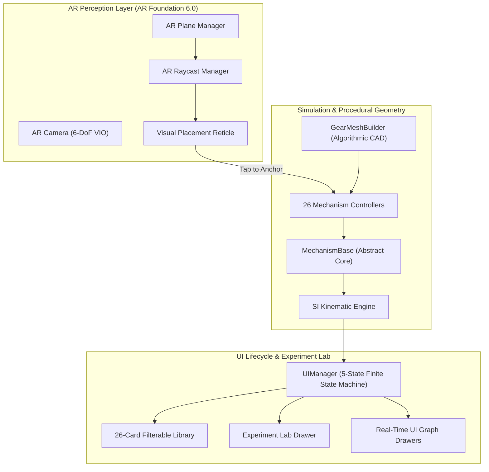

# MECH-XR — Augmented Reality Mechanical Systems Explorer

[-black?logo=unity)](https://unity.com/)
[-brightgreen?logo=android)](https://developer.android.com/)
[](https://developers.google.com/ar)
[](Documentation/Development/TEST_REPORT.md)
[](LICENSE)
[-blueviolet)](Builds/README.md)

> **Explore, simulate, and analyze complex mechanical assemblies in physical space through interactive mobile Augmented Reality.**

**MECH-XR** is a mobile Augmented Reality (AR) mechanical engineering exploration platform built on **Unity 6.3 LTS** and **Google ARCore**. It allows engineers, designers, and students to place 3D mechanical mechanisms onto physical tabletops and floors, observe kinematic motion conversion, inspect individual components in spatial isolation, and conduct dynamic engineering experiments with live mathematical telemetry and thermodynamic power analysis.

---

## Application Showcase

<div align="center">

| 📚 Mechanism Library | 🌐 Augmented Reality Kinematics | 🔬 Scientific Experiment Lab |
| :---: | :---: | :---: |
|  |  |  |
| *26 mechanisms across 4 categories with smooth vertical touch scrolling* | *Millimeter-accurate surface tracking, dynamic reticle & 6-DoF spatial anchoring* | *Real-time RPM/torque modulation, efficiency tuning & thermodynamic power graphs* |

</div>

<br/>

```text
+-----------------------------------------------------------------------------------+
|  MECH-XR INTERACTIVE AR WORKFLOW                                                  |
|                                                                                   |
|  [ 1. Catalog Browser ] ---> [ 2. AR Plane Detection ] ---> [ 3. 3D Kinematics ]  |
|  Filter 26 mechanisms        Scan horizontal surfaces        Observe live motion  |
|  across 4 categories.        and anchor with 6-DoF.          at adjustable RPM.   |
|                                                                                   |
|  [ 4. Part Detachment ] <--- [ 5. Exploded View ]     <--- [ 6. Experiment Lab ] |
|  Isolate gears/shafts        Simultaneously explode          Adjust speed, torque |
|  with 360° part spin.        assemblies along axes.          and track SI graphs. |
+-----------------------------------------------------------------------------------+
```

*For capture specifications and showcase details, see [`Screenshots/README.md`](Screenshots/README.md).*

---

## Overview

Traditional 2D blueprints, textbook diagrams, and video animations show what a mechanism looks like, but fail to convey how conjugate teeth interact, how multi-stage planetary gears divide torque, or how linkage angles affect transmission efficiency. Physical test benches provide hands-on experience but are capital-intensive, occupy physical floor space, and cannot provide cutaway X-ray visibility into internal bearings, pistons, and gear teeth.

**MECH-XR transforms everyday Android smartphones into an interactive mechanical engineering laboratory:**
- **Zero Asset Bloat**: Every gear tooth, helical flute, camshaft lobe, and engine crosshead is generated algorithmically at runtime using pure C# trigonometric procedures (`GearMeshBuilder.cs`), keeping the entire production APK under **28 MB**.
- **Spatial Understanding**: Walk around, crouch beneath, and inspect life-sized 3D mechanical assemblies anchored solidly in physical space using high-precision Visual-Inertial Odometry (VIO).
- **Quantitative Simulation**: Adjust input shaft speed from 10 to 300 RPM, modulate input torque from 0.1 to 500 N·m, and observe real-time power transmission, torque multiplication, and thermodynamic heat dissipation.

---

## Core Features

### 1. Augmented Reality Mechanism Visualization
- **Surface Anchoring**: Automatic horizontal plane detection anchors mechanisms to tabletops, workbenches, or floors with millimeter stability.
- **Intuitive Touch Controls**:
  - *One-Finger Horizontal Drag*: Rotate the placed mechanical assembly around its vertical world axis.
  - *Two-Finger Pinch*: Continuously scale the assembly between $0.4\times$ and $2.5\times$ with live HUD scale feedback.
  - *Tap-to-Inspect*: Tap any gear, shaft, or bearing collider to isolate and fly it forward into single-component inspection mode.

### 2. Component Isolation & Exploded Views
- **Axial Detachment**: Selected components translate outward along their functional mechanical axis.
- **360° Part Spin**: Freely rotate detached components around their centroid to examine involute tooth profiles, keyways, and bearing journals.
- **Simultaneous Exploded View**: Explode all assembly components simultaneously along calculated vectors to inspect internal conjugate meshing and bearing mountings.

### 3. Scientific Experiment Lab
A collapsible analytical drawer provides dynamic experimentation:
- **Velocity Slider ($10 - 300\text{ RPM}$)**: Continuous drag, track tap, and fine-tuning steppers ($[-10]$ / $[+10]$).
- **Torque Slider ($0.1 - 500\text{ N}\cdot\text{m}$)**: Sets applied input shaft torque.
- **Efficiency Slider ($50\% - 100\%$)**: Simulates variable lubrication and gear tooth surface wear.
- **Motion Playback Controls**: Run, Pause, Reverse Rotation direction, and Reset to standard 120 RPM.
- **4 Real-Time Graph Channels**:
  - `RPM`: Compares input motor speed ($N_{\text{in}}$) with reduction output speed ($N_{\text{out}}$).
  - `TORQUE`: Compares applied torque ($T_{\text{in}}$) with mechanical output torque ($T_{\text{out}}$).
  - `SPEED/TIME`: Tracks dynamic angular acceleration curves ($\alpha = d\omega/dt$).
  - `POWER/LOSS`: Renders three thermodynamic energy channels: Sky Blue (Input Power), Emerald Green (Useful Output Power), and Crimson Red (Thermal Dissipation).
- **Engineering Regimes (Presets)**: Instant one-tap access to standard operational states (`High Speed`, `High Torque`, `Industrial`, `Low Efficiency`).
- **A/B Live Snapshot Comparison**: Lock baseline telemetry into Memory A and observe real-time difference deltas ($\Delta N, \Delta T, \Delta P, \Delta P_{\text{loss}}$) as operating variables change.

### 4. Robust Android Mobile Touch Architecture
- **Phase 6.1 Touch Scroll Engine**: Custom-engineered event routing with `raycastTarget = true` distribution and dynamic layout expansion ($4398\text{ px}$ height), ensuring responsive touch scrolling across high-refresh-rate Android touchscreens.

---

## Mechanical Systems Catalog

MECH-XR includes 26 procedural mechanical assemblies structured across four core engineering domains:

| Domain | # | Mechanism Name | Kinematic Law / Ratio | Core Engineering Application |
|:---|:---:|:---|:---|:---|
| **GEARS** | 01 | **Spur Gear Pair** | $i = Z_2/Z_1 = 40/20 = 2.0 : 1$ | Fundamental external conjugate involute power transmission. |
| | 02 | **Bevel Gear Pair** | $i = Z_2/Z_1 = 30/15 = 2.0 : 1$ | 90° intersecting shaft transmission with conical pitch surfaces. |
| | 03 | **Worm Gear Drive** | $i = Z_{\text{wheel}}/Z_{\text{worm}} = 30/1 = 30 : 1$ | High-ratio compact reduction with inherent self-locking ($\gamma < \phi$). |
| | 04 | **Planetary Gearbox** | $i = 1 + Z_{\text{ring}}/Z_{\text{sun}} = 4.0 : 1$ | Epicyclic torque division across 3 rotating planet gears. |
| | 05 | **Rack and Pinion** | $v = \frac{\pi \cdot m \cdot Z \cdot N}{60} = 439.8\text{ mm/s}$ | Rotary-to-linear conversion for automotive steering and machine beds. |
| | 06 | **Belt & Pulley Drive** | $i = D_2/D_1 = 120/60 = 2.0 : 1$ | Flexible friction power transmission across wide center distances. |
| | 07 | **Simple Idler Train** | $i = Z_{\text{driven}}/Z_{\text{driver}} = 2.0 : 1$ | Direction reversal without altering net velocity ratio. |
| | 08 | **Compound Gear Train** | $i = (Z_2/Z_1) \times (Z_4/Z_3) = 6.0 : 1$ | Multi-stage speed reduction across parallel intermediate countershafts. |
| | 09 | **Reverted Gear Train** | $a_1 = a_2 = 105\text{ mm}, i = 3.0 : 1$ | Coaxial input and output shafts (clockwork and automotive gearboxes). |
| | 10 | **Internal Gear Pair** | $i = Z_{\text{internal}}/Z_{\text{pinion}} = 3.0 : 1$ | Same-direction rotation with compact center distance ($a = 70\text{ mm}$). |
| | 11 | **Helical Gear Pair** | $\beta = \pm 20.0^\circ, i = 2.0 : 1$ | Gradual progressive tooth engagement with axial thrust generation. |
| | 12 | **Herringbone Gear Pair** | Double-helical chevrons, $i = 2.0 : 1$ | Opposing tooth helices cancel net axial thrust forces ($F_{\text{net}} = 0\text{ N}$). |
| | 13 | **Automotive Differential** | $\omega_{\text{carrier}} = \frac{\omega_{\text{left}} + \omega_{\text{right}}}{2}$ | Willis axle law with dynamic turn-bias torque distribution. |
| | 14 | **Harmonic Drive** | $i = \frac{Z_f}{Z_c - Z_f} = 24.0 : 1$ | Strain wave gear, flexible spline, zero-backlash robotic joints. |
| **ENGINES** | 15 | **Four-Stroke IC Engine** | $720^\circ\text{ cycle}, N_{\text{cam}} = 0.5 \cdot N_{\text{crank}}$ | Full 4-stroke cycle (Intake, Compression, Power, Exhaust); 1:2 camshaft timing. |
| | 16 | **Slider-Crank Mechanism** | $S = 2r = 80\text{ mm}, \lambda = r/l = 0.333$ | Rotary-to-reciprocating conversion; secondary harmonic acceleration unbalance. |
| | 17 | **Cam & Roller Follower** | $R_b = 35\text{ mm}, h = 18\text{ mm}$ | Simple harmonic rise ($60^\circ-180^\circ$), top dwell, harmonic fall, base dwell. |
| | 18 | **Reciprocating Pump** | $Q = A \cdot S \cdot N \cdot 1000 = 20.36\text{ L/min}$ | Positive displacement liquid pumping with suction/delivery check valves. |
| **LINKAGES**| 19 | **Planar Four-Bar Linkage** | $s+l = 160\text{ mm} \le p+q = 185\text{ mm}$ | Grashof Class I crank-rocker linkage with continuous $360^\circ$ crank sweep. |
| | 20 | **Crank-Rocker Mechanism** | $Q = \frac{180^\circ + \alpha}{180^\circ - \alpha} \approx 1.16 : 1$ | Asymmetric advance/return cycle time for industrial shaping machines. |
| | 21 | **Geneva Mechanism** | 4-slot cross, $\Delta\theta = 90^\circ$ | Intermittent motion indexing (25% advance duty cycle, 75% dwell lock). |
| | 22 | **Scotch Yoke Mechanism** | $x(t) = r\cos\omega t, S = 2r = 80\text{ mm}$ | Pure Simple Harmonic Motion (zero secondary harmonic angularity distortion). |
| **DRIVES** | 23 | **Universal (Cardan) Joint** | $\tan\theta_2 = \tan\theta_1\cos\beta, \beta = 20.0^\circ$ | 2nd-harmonic speed ripple ($\pm 6.2\%$, peak ratio $\sec\beta = 1.064\times$). |
| | 24 | **Chain & Sprocket Drive** | $Z_1 = 15, Z_2 = 30, i = 2.0 : 1$ | Non-slip positive power transmission; chordal action polygonal ripple ($2.19\%$). |
| | 25 | **Ratchet and Pawl** | $Z = 24, \Delta\theta = 15.0^\circ, i = 24 : 1$ | One-way mechanical freewheel and discrete indexing advance. |
| | 26 | **Lead Screw and Nut** | $L = 6\text{ mm/rev}, F = \frac{2\pi\eta T}{L} = 9948\text{ N}$ | High-thrust linear clamping; self-locking ($\lambda = 5.2^\circ < \phi = 8.53^\circ$). |

---

## Experiment Lab & Physics Engine

MECH-XR simulates rotational mechanics using standard International System of Units (SI):

### 1. Rotational Kinematics & Angular Velocity
$$\omega = \frac{2\pi \cdot N}{60}\quad [\text{rad/s}], \qquad \omega_{\text{out}} = \frac{\omega_{\text{in}}}{i}\quad [\text{rad/s}]$$

### 2. Mechanical Power & Conservation of Energy
$$P_{\text{in}} = T_{\text{in}} \cdot \omega_{\text{in}} = \frac{2\pi \cdot N_{\text{in}} \cdot T_{\text{in}}}{60}\quad [\text{W}]$$

$$P_{\text{out}} = \eta \cdot P_{\text{in}}\quad [\text{W}], \qquad P_{\text{loss}} = (1 - \eta) \cdot P_{\text{in}}\quad [\text{W}]$$

### 3. Torque Multiplication Across Reduction Ratios
$$T_{\text{out}} = \eta \cdot T_{\text{in}} \cdot i\quad [\text{N}\cdot\text{m}]$$

### Operational Regimes (Presets)

| Regime | Input Speed | Input Torque | Efficiency | Input Power | Output Power | Power Loss |
|:---|---:|---:|---:|---:|---:|---:|
| **High Speed** | $240\text{ RPM}$ | $5.0\text{ N}\cdot\text{m}$ | $96\%$ | $125.66\text{ W}$ | $120.64\text{ W}$ | $5.03\text{ W}$ |
| **High Torque** | $60\text{ RPM}$ | $50.0\text{ N}\cdot\text{m}$ | $94\%$ | $314.16\text{ W}$ | $295.31\text{ W}$ | $18.85\text{ W}$ |
| **Industrial** | $150\text{ RPM}$ | $30.0\text{ N}\cdot\text{m}$ | $92\%$ | $471.24\text{ W}$ | $433.54\text{ W}$ | $37.70\text{ W}$ |
| **Low Efficiency** | $120\text{ RPM}$ | $20.0\text{ N}\cdot\text{m}$ | $75\%$ | $251.33\text{ W}$ | $188.50\text{ W}$ | $62.83\text{ W}$ |

> **Note on Analytical Models vs. Physical Measurements**: Telemetry values in MECH-XR represent theoretical results derived from kinematic equations and idealized efficiency parameters. The application is an analytical simulator and does not measure physical mechanical strain from mobile hardware.

---

## Architecture & System Design

MECH-XR is built on a 3-tier decoupled software architecture:



### UI Finite State Machine
To guarantee zero panel overlap and reliable touch dispatching, `UIManager.cs` enforces an exclusive 5-state lifecycle:
1. **`Library`**: Catalog browser displaying 26 mechanism cards grouped into 4 categories (`ALL`, `GEARS`, `ENGINES`, `LINKAGES`, `DRIVES`).
2. **`ARScanning`**: Prompts the user to pan camera over horizontal surfaces; activates the placement reticle.
3. **`ARPlaced`**: Instantiates procedural mechanism root at anchor position; displays HUD dock and Experiment Lab toggle.
4. **`ComponentInspection`**: Flies isolated component forward along its mechanical axis with 360° rotational inspection.
5. **`ExplodedView`**: Triggers multi-part explosion vectors simultaneously outward from assembly center.

---

## Technology Stack

| Layer | Component | Specification |
|:---|:---|:---|
| **Engine** | Unity | `6000.3.27f2` (Unity 6.3 LTS) |
| **Language & Runtime** | C# | C# 9.0 (.NET Standard 2.1) |
| **AR Framework** | Unity AR Foundation | Version `6.0.8` |
| **AR Provider** | Google ARCore XR Plugin | Version `6.0.8` |
| **Target Hardware** | Android Mobile | 64-bit ARM (`arm64-v8a`), Min SDK 26, Target SDK 36 |
| **Rendering** | Forward Pipeline | Mobile metallic shaders, dynamic batching, 60 FPS |
| **UI Framework** | Unity UGUI + TextMeshPro | Responsive Canvas Scaler (1080x1920 reference) |

---

## Repository Structure

```text
MECH-XR/
├── Assets/
│   ├── Art/                 # Materials and mobile PBR shaders (Cast Iron, Steel, Bronze, Gold)
│   ├── Editor/              # SceneSetupTool (71 tests) & AndroidBuildTool automation
│   ├── Fonts/               # Inter typography font family
│   ├── Scenes/              # Main AR entry scene (MainScene.unity)
│   ├── Scripts/
│   │   ├── AR/              # ARPlacementManager & PlacementReticle (ARCore 6-DoF tracking)
│   │   ├── Common/          # Base inspectable & interactive component classes
│   │   ├── Interaction/     # Touch rotation, pinch scaling, and axial detachment
│   │   ├── Mechanisms/      # 26 procedural kinematic controllers (MechanismBase derivatives)
│   │   ├── Procedural/      # Procedural CAD gear mesh generator (GearMeshBuilder)
│   │   └── UI/              # 5-state FSM, experiment drawer & dynamic graph renderers
│   ├── TextMesh Pro/        # Typography resources, settings, and SDF font assets
│   └── XR/                  # ARCore and XR Simulation loader settings
├── Builds/
│   ├── MECH-XR-PHASE6-1-v2.apk  # Verified Android production release (v1.1, Build 2)
│   └── README.md            # Release specifications & ADB installation guide
├── Documentation/
│   ├── Architecture/        # PROJECT_ARCHITECTURE.md, SYSTEM_DESIGN.md
│   ├── Engineering/         # MECHANISM_CATALOG.md, MECHANISM_MATH.md, EXPERIMENT_LAB_GUIDE.md,
│   │                        # EXPERIMENT_LAB_MATHEMATICS.md
│   ├── Development/         # BUILD_GUIDE.md, TEST_REPORT.md, PHASE_HISTORY.md
│   └── Reference/           # MECHANICAL_SYSTEMS_HANDBOOK.md (Exhaustive technical reference manual)
├── Screenshots/
│   └── README.md            # Device capture guidelines & showcase specifications
├── Packages/                # Package manifest & lockfiles
├── ProjectSettings/         # Unity engine settings, Android target SDK 36, ARM64 ABI
├── CONTRIBUTING.md          # Contribution guidelines, development standards, PR workflow
├── LICENSE                  # MIT License
└── README.md                # Project documentation root
```

---

## Installation & Sideloading

### Device Requirements
- Android smartphone running **Android 8.0 (API 26) or higher**.
- **64-bit ARM CPU (`arm64-v8a`)**.
- **Google Play Services for AR (ARCore)** installed from the Google Play Store.

### Option A: Direct Install via ADB (Recommended)
Connect your phone via USB with **USB Debugging** enabled:
```bash
# Verify device connection
adb devices

# Install APK directly (allows update without data loss)
adb install -r Builds/MECH-XR-PHASE6-1-v2.apk
```

### Option B: Sideload via Phone File Manager
1. Copy `Builds/MECH-XR-PHASE6-1-v2.apk` to your phone's `Download/` folder.
2. Open your device's **Files** app and tap the APK.
3. Permit installation from unknown sources if prompted.
4. Launch **MECH-XR** from your app drawer.

---

## Development Setup & Build Instructions

### Prerequisites
- **Unity Hub** with **Unity 6000.3.27f2 (6.3 LTS)** installed.
- **Android Build Support** module (OpenJDK, Android SDK & NDK Tools).

### Opening the Project
1. Clone the repository:
   ```bash
   git clone https://github.com/JeyaVardhan-L/AR_Gear_Mechanisms.git
   ```
2. In Unity Hub, click **Add > Add project from disk** and select the repository root directory.
3. Open the project using **Unity 6000.3.27f2**.

### Building the Android APK
From the Unity Editor top menu:
- Select **`Tools > MechXR > Build Android APK (Release)`**
- Or compile via command-line batchmode:
  ```powershell
  & "C:\Program Files\Unity\Hub\Editor\6000.3.27f2\Editor\Unity.exe" `
    -batchmode -quit `
    -projectPath . `
    -executeMethod MechXR.Editor.AndroidBuildTool.BuildAndroidApkPhase6_1 `
    -logFile build.log
  ```

---

## Automated Testing & Verification Suite

MECH-XR includes an automated headless test suite in [`Assets/Editor/SceneSetupTool.cs`](Assets/Editor/SceneSetupTool.cs) covering **71 test cases**:

```powershell
& "C:\Program Files\Unity\Hub\Editor\6000.3.27f2\Editor\Unity.exe" `
  -batchmode -quit `
  -projectPath . `
  -executeMethod MechXR.Editor.SceneSetupTool.BuildMainSceneAndTest `
  -logFile test.log
```

- **Kinematic & CAD Geometry (`TEST-01` to `TEST-20`)**: Verifies gear ratios, tooth meshes, exploded vectors, and axial detachment.
- **Typography Audit (`TEST-21`)**: 176/176 TextMeshProUGUI components validated with non-null fonts.
- **UI State Machine (`TEST-P4.1-01` to `TEST-P4.1-10`)**: 10 tests confirming zero panel overlap across 10 consecutive mechanism transitions.
- **Scientific Experiment Lab (`TEST-P5-01` to `TEST-P5-16`)**: Verifies velocity mapping, steppers, torque power laws, presets, and Phase 5 mechanisms.
- **Phase 6 Mechanism Expansion (`TEST-P6-01` to `TEST-P6-14`)**: Validates all 12 Phase 6 mechanisms (Four-Stroke Engine 720° cycle, Cardan joint ripple, Geneva duty cycle, Lead screw self-locking).
- **Physical Touch Scrolling (`TEST-P6.1-01` to `TEST-P6.1-10`)**: Simulates mobile upward/downward drag swipes, raycast hit targets, dynamic layout expansion to 4398 px, and category resets.

**Test Result: 71 / 71 Tests Passed (0 Failures).** Full logs available in [`Documentation/Development/TEST_REPORT.md`](Documentation/Development/TEST_REPORT.md).

---

## Documentation Index

| Topic | Document Path | Description |
|:---|:---|:---|
| **Technical Reference Manual** | [`Documentation/Reference/MECHANICAL_SYSTEMS_HANDBOOK.md`](Documentation/Reference/MECHANICAL_SYSTEMS_HANDBOOK.md) | Exhaustive 13-part manual with engineering analysis, VIO tracking, and architecture FAQ. |
| **Experiment Lab Mathematics** | [`Documentation/Engineering/EXPERIMENT_LAB_MATHEMATICS.md`](Documentation/Engineering/EXPERIMENT_LAB_MATHEMATICS.md) | Mathematical derivations, thermodynamic power equations, and parameter reconciliation. |
| **System Architecture** | [`Documentation/Architecture/SYSTEM_DESIGN.md`](Documentation/Architecture/SYSTEM_DESIGN.md) | Architectural specification, state machine flowcharts, and procedural CAD pipelines. |
| **Mechanism Catalog** | [`Documentation/Engineering/MECHANISM_CATALOG.md`](Documentation/Engineering/MECHANISM_CATALOG.md) | Detailed specifications, materials, tooth counts, and kinematics for all 26 mechanisms. |
| **Experiment Lab User Guide** | [`Documentation/Engineering/EXPERIMENT_LAB_GUIDE.md`](Documentation/Engineering/EXPERIMENT_LAB_GUIDE.md) | Practical guide to conducting experiments, presets, and A/B comparative studies. |
| **Build & Setup Guide** | [`Documentation/Development/BUILD_GUIDE.md`](Documentation/Development/BUILD_GUIDE.md) | Step-by-step instructions for Android SDK configuration and APK compilation. |
| **Development History** | [`Documentation/Development/PHASE_HISTORY.md`](Documentation/Development/PHASE_HISTORY.md) | Chronological record of project progression across Phases 1 through 6.1. |
| **Verification & Tests** | [`Documentation/Development/TEST_REPORT.md`](Documentation/Development/TEST_REPORT.md) | Detailed logs and acceptance criteria for all 71 automated tests. |
| **Contributing Guide** | [`CONTRIBUTING.md`](CONTRIBUTING.md) | Development standards, coding conventions, and pull request workflow. |

---

## Known Limitations

- **Planar Surface Anchoring**: Real-world surface detection currently targets horizontal planar surfaces (desks, workbenches, floors). Vertical wall mounting and environmental occlusion meshes are not active.
- **Kinematic Simulation Scope**: Motion simulations model geometric and kinematic relationships with user-defined efficiency factors. They are not structural finite element analysis (FEA) or computational fluid dynamics (CFD) solvers.
- **Pump Hydraulic Model**: The reciprocating pump models theoretical volumetric displacement without simulating downstream pipe friction head losses.

---

## License

This project is licensed under the **MIT License** — see the [LICENSE](LICENSE) file for details.

Developed by **JeyaVardhan-L** (2026).
