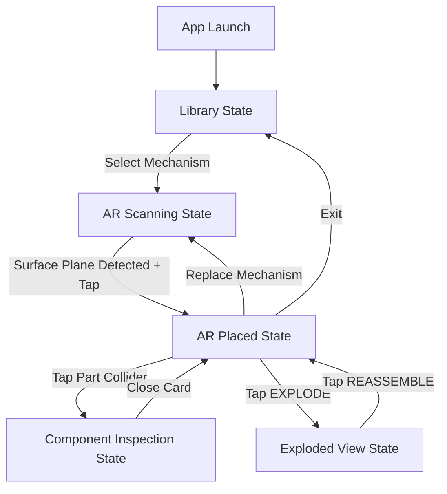

# MECH-XR — Augmented Reality Mechanical Engineering Laboratory

[-black?logo=unity)](https://unity.com/)
[-brightgreen?logo=android)](https://developer.android.com/)
[](https://developers.google.com/ar)
[](Documentation/Development/TEST_REPORT.md)
[](LICENSE)
[-blueviolet)](Builds/README.md)

**MECH-XR** is a mobile Augmented Reality (AR) mechanical engineering learning and experimentation platform built with **Unity 6.3 LTS** and **Google ARCore**. It enables students, instructors, and engineers to anchor 3D mechanical mechanisms onto physical surfaces, inspect individual components in spatial isolation, observe live kinematic motion, and explore real-time thermodynamic and SI mechanical calculations through an interactive Scientific Experiment Lab.

---

## Table of Contents

- [1. Problem Statement & Educational Need](#1-problem-statement--educational-need)
- [2. Core Features & Capabilities](#2-core-features--capabilities)
- [3. The 26-Mechanism Engineering Catalog](#3-the-26-mechanism-engineering-catalog)
- [4. Scientific Experiment Lab & SI Mathematics](#4-scientific-experiment-lab--si-mathematics)
- [5. System Architecture & UI State Machine](#5-system-architecture--ui-state-machine)
- [6. Technology Stack](#6-technology-stack)
- [7. Repository Structure](#7-repository-structure)
- [8. Android Installation & Sideloading](#8-android-installation--sideloading)
- [9. Development Setup & Build Instructions](#9-development-setup--build-instructions)
- [10. Automated Testing & Verification Suite](#10-automated-testing--verification-suite)
- [11. Complete Documentation Index](#11-complete-documentation-index)
- [12. Limitations & Future Roadmap](#12-limitations--future-roadmap)
- [13. License & Attribution](#13-license--attribution)

---

## 1. Problem Statement & Educational Need

Traditional mechanical engineering pedagogy relies heavily on static two-dimensional textbook diagrams, blackboard schematics, and video demonstrations. While physical machine laboratories provide tactile familiarity, physical test rigs are capital-intensive, occupy significant laboratory floor space, require routine maintenance, and cannot provide real-time X-ray visibility into internal conjugate gear teeth, planetary spider carriers, or valve timings.

**MECH-XR** bridges the gap between theoretical mechanics and spatial intuition:
- **Spatial Anchoring**: Place life-sized virtual mechanisms directly onto desks, workbenches, or classroom floors using Google ARCore 6-DoF tracking.
- **X-Ray & Exploded Inspection**: Explode complex assemblies outward or detach individual gears, shafts, and linkages to inspect tooth profiles, materials, and load ratings.
- **Dynamic Experimentation**: Interactively adjust input RPM, applied torque, and mesh efficiency to visualize the speed-torque trade-off and thermodynamic thermal dissipation in real time.

---

## 2. Core Features & Capabilities

- **Pure Procedural CAD Generation**: Every spur gear, bevel cone, Acme worm, helical tooth, cam profile, and engine piston is generated dynamically at runtime using trigonometric mathematics (`GearMeshBuilder.cs`). Zero external proprietary 3D model dependencies.
- **26 Complete Mechanical Mechanisms**: Structured across 4 engineering domains: Gear Trains, Engines, Linkages, and Industrial Drives.
- **Multi-State Mobile Lifecycle**: Exclusive 5-state UI finite state machine (`Library`, `ARScanning`, `ARPlaced`, `ComponentInspection`, `ExplodedView`) preventing overlapping panels or touch collisions.
- **Touch Gesture Interaction**:
  - *One-Finger Horizontal Drag*: Rotate placed mechanism assembly on the surface plane.
  - *Two-Finger Pinch*: Continuously scale model between $0.4\times$ and $2.5\times$ with live HUD scale indicator.
  - *Part Tap*: Isolate and fly out any component along its mechanical axis with 360° rotational inspection.
  - *One-Tap Exploded View*: Simultaneously explode all components outward into clear spatial view.
- **Scientific Experiment Lab Drawer**:
  - Live velocity modulation ($10 - 300\text{ RPM}$) with continuous drag, track tap, and fine-tuning steppers ($[-10]$ / $[+10]$).
  - Torque slider ($0.1 - 500\text{ N}\cdot\text{m}$) and efficiency slider ($50\% - 100\%$).
  - 4 Dynamic Graph modes: `RPM`, `TORQUE`, `SPEED/TIME`, and `POWER/LOSS` (Sky Blue input, Emerald Green output, Crimson Red thermal dissipation).
  - 4 Engineering Presets (`High Speed`, `High Torque`, `Industrial`, `Low Efficiency`).
  - A/B Live Snapshot Comparison with automatic delta indicators ($\Delta N, \Delta T, \Delta P, \Delta P_{\text{loss}}$).
- **Phase 6.1 Touch Scrolling Repair**: Full physical touchscreen scrolling compatibility verified on modern high-refresh-rate Android devices (Xiaomi POCO X6 5G).

---

## 3. The 26-Mechanism Engineering Catalog

The application features 26 procedurally synthesized mechanical assemblies:

| Category | # | Mechanism Name | Kinematic Law / Ratio | Core Engineering Concept |
|:---|:---:|:---|:---|:---|
| **GEARS** | 01 | **Spur Gear Pair** | $i = Z_2/Z_1 = 40/20 = 2.0 : 1$ | Conjugate involute tooth meshing, 20° pressure angle. |
| | 02 | **Bevel Gear Pair** | $i = Z_2/Z_1 = 30/15 = 2.0 : 1$ | 90° intersecting shaft power transmission, conical pitch surfaces. |
| | 03 | **Worm Gear Drive** | $i = Z_{\text{wheel}}/Z_{\text{worm}} = 30/1 = 30 : 1$ | Massive reduction, self-locking ($\gamma = 7.39^\circ < \phi = 8.53^\circ$). |
| | 04 | **Planetary Gearbox** | $i = 1 + Z_{\text{ring}}/Z_{\text{sun}} = 1 + 60/20 = 4.0 : 1$ | Epicyclic torque division across 3 rotating planet gears. |
| | 05 | **Rack and Pinion** | $v = \frac{\pi \cdot m \cdot Z \cdot N}{60} = 439.8\text{ mm/s}$ | Rotary-to-linear conversion, steering and CNC axis drive. |
| | 06 | **Belt & Pulley Drive** | $i = D_2/D_1 = 120/60 = 2.0 : 1$ | Flexible friction power transmission, center distance isolation. |
| | 07 | **Simple Idler Train** | $i = Z_{\text{driven}}/Z_{\text{driver}} = 2.0 : 1$ | Direction reversal without affecting velocity ratio. |
| | 08 | **Compound Gear Train** | $i = (Z_2/Z_1) \times (Z_4/Z_3) = 2.0 \times 3.0 = 6.0 : 1$ | Compact high-ratio speed reduction across parallel countershafts. |
| | 09 | **Reverted Gear Train** | $a_1 = a_2 = 105\text{ mm}, i = 3.0 : 1$ | Coaxial input and output shafts (clockwork and automotive gearboxes). |
| | 10 | **Internal Gear Pair** | $i = Z_{\text{internal}}/Z_{\text{pinion}} = 60/20 = 3.0 : 1$ | Same-direction rotation, compact center distance ($a = 70\text{ mm}$). |
| | 11 | **Helical Gear Pair** | $\beta = \pm 20.0^\circ, i = 2.0 : 1$ | Gradual tooth engagement, higher load capacity, axial thrust. |
| | 12 | **Herringbone Gear Pair** | Double-helical chevrons, $i = 2.0 : 1$ | Opposing tooth helices cancel net axial thrust forces ($F_{\text{net}} = 0\text{ N}$). |
| | 13 | **Automotive Differential** | $\omega_{\text{carrier}} = \frac{\omega_{\text{left}} + \omega_{\text{right}}}{2}$ | Willis axle law, dynamic turn-bias torque distribution. |
| | 14 | **Harmonic Drive** | $i = \frac{Z_f}{Z_c - Z_f} = \frac{48}{50 - 48} = 24.0 : 1$ | Strain wave gear, flexible spline, zero-backlash robotics. |
| **ENGINES** | 15 | **Four-Stroke IC Engine** | $720^\circ\text{ cycle}, N_{\text{cam}} = 0.5 \cdot N_{\text{crank}}$ | Intake, Compression, Power, Exhaust strokes; 1:2 camshaft timing. |
| | 16 | **Slider-Crank Mechanism** | $S = 2r = 80\text{ mm}, \lambda = r/l = 0.333$ | Rotary-to-reciprocating motion, secondary harmonic acceleration. |
| | 17 | **Cam & Roller Follower** | $R_b = 35\text{ mm}, h = 18\text{ mm}$ | Harmonic rise ($60^\circ-180^\circ$), top dwell, harmonic fall, base dwell. |
| | 18 | **Reciprocating Pump** | $Q = A \cdot S \cdot N \cdot 1000 = 20.36\text{ L/min}$ | Piston displacement, non-return suction and delivery check valves. |
| **LINKAGES**| 19 | **Planar Four-Bar Linkage** | $s+l = 160\text{ mm} \le p+q = 185\text{ mm}$ | Grashof Class I crank-rocker, continuous 360° input rotation. |
| | 20 | **Crank-Rocker Mechanism** | $Q = \frac{180^\circ + \alpha}{180^\circ - \alpha} \approx 1.16 : 1$ | Asymmetric advance/return time ratio for machine tool shapers. |
| | 21 | **Geneva Mechanism** | 4-slot cross, $\Delta\theta = 90^\circ$ | Intermittent indexing (25% motion duty cycle, 75% stationary dwell). |
| | 22 | **Scotch Yoke Mechanism** | $x(t) = r\cos\omega t, S = 2r = 80\text{ mm}$ | Pure Simple Harmonic Motion (zero secondary harmonic distortion). |
| **DRIVES** | 23 | **Universal (Cardan) Joint** | $\tan\theta_2 = \tan\theta_1\cos\beta, \beta = 20.0^\circ$ | 2nd-harmonic velocity ripple ($\pm 6.2\%$, $\sec\beta = 1.064\times$). |
| | 24 | **Chain & Sprocket Drive** | $Z_1 = 15, Z_2 = 30, i = 2.0 : 1$ | Positive non-slip transmission, chordal action polygonal effect ($2.19\%$). |
| | 25 | **Ratchet and Pawl** | $Z = 24, \Delta\theta = 15.0^\circ, i = 24 : 1$ | One-way mechanical freewheel and indexing advance mechanism. |
| | 26 | **Lead Screw and Nut** | $L = 6\text{ mm/rev}, F = \frac{2\pi\eta T}{L} = 9948\text{ N}$ | Rotary-to-linear high-thrust clamping, self-locking ($\lambda = 5.2^\circ < \phi = 8.53^\circ$). |

---

## 4. Scientific Experiment Lab & SI Mathematics

The Experiment Lab models rotational physics using rigorous SI units:

### Governing Equations
$$\omega = \frac{2\pi \cdot N}{60}\quad [\text{rad/s}], \qquad P = T \cdot \omega = \frac{2\pi \cdot N \cdot T}{60}\quad [\text{W}]$$

$$T_{\text{out}} = \eta \cdot T_{\text{in}} \cdot i\quad [\text{N}\cdot\text{m}], \qquad P_{\text{loss}} = (1 - \eta) \cdot P_{\text{in}}\quad [\text{W}]$$

### Standard Operating Presets
- **High Speed**: $240\text{ RPM}$, $5.0\text{ N}\cdot\text{m}$, $\eta = 96\% \implies P_{\text{in}} = 125.66\text{ W}$, $P_{\text{loss}} = 5.03\text{ W}$, $T_{\text{out}} = 9.60\text{ N}\cdot\text{m}$ (at $2:1$).
- **High Torque**: $60\text{ RPM}$, $50.0\text{ N}\cdot\text{m}$, $\eta = 94\% \implies P_{\text{in}} = 314.16\text{ W}$, $P_{\text{loss}} = 18.85\text{ W}$, $T_{\text{out}} = 94.00\text{ N}\cdot\text{m}$ (at $2:1$).
- **Industrial**: $150\text{ RPM}$, $30.0\text{ N}\cdot\text{m}$, $\eta = 92\% \implies P_{\text{in}} = 471.24\text{ W}$, $P_{\text{loss}} = 37.70\text{ W}$, $T_{\text{out}} = 55.20\text{ N}\cdot\text{m}$ (at $2:1$).
- **Low Efficiency**: $120\text{ RPM}$, $20.0\text{ N}\cdot\text{m}$, $\eta = 75\% \implies P_{\text{in}} = 251.33\text{ W}$, $P_{\text{loss}} = 62.83\text{ W}$, $T_{\text{out}} = 30.00\text{ N}\cdot\text{m}$ (at $2:1$).

---

## 5. System Architecture & UI State Machine



See the complete architectural design specification in [`Documentation/Architecture/SYSTEM_DESIGN.md`](Documentation/Architecture/SYSTEM_DESIGN.md).

---

## 6. Technology Stack

| Layer | Component | Specification |
|:---|:---|:---|
| **Development Engine** | Unity | 6000.3.27f2 (Unity 6.3 LTS) |
| **Language & Runtime** | C# | .NET Standard 2.1 |
| **AR Framework** | Unity AR Foundation | Version 6.0.8 |
| **AR Provider** | Google ARCore XR Plugin | Version 6.0.8 |
| **Target Hardware** | Android Mobile | ARM64 (`arm64-v8a`), Min SDK 26 (Oreo), Target SDK 36 (Android 16) |
| **Rendering** | Forward Pipeline | Built-in mobile metallic shaders, dynamic batching, 60 FPS |
| **UI Framework** | Unity UGUI + TextMeshPro | Resolution-independent Canvas Scaler (1080x1920 reference) |

---

## 7. Repository Structure

```text
AR_Gear_Mechanisms/
├── Assets/
│   ├── Editor/              # Scene setup, build automation & test runner scripts
│   ├── Materials/           # Mobile metallic PBR materials (Steel, Bronze, Gold)
│   ├── Prefabs/             # UI & AR placement reticle prefabs
│   ├── Scenes/              # Main AR entry scene (MainScene.unity)
│   ├── Scripts/
│   │   ├── AR/              # Surface tracking, reticle & placement managers
│   │   ├── Common/          # Base inspectable & interactive component classes
│   │   ├── Mechanisms/      # 26 standalone kinematic mechanism controllers
│   │   ├── Procedural/      # Procedural CAD gear mesh generator (GearMeshBuilder)
│   │   └── UI/              # Finite state machine, experiment drawer & graphs
│   ├── Shaders/             # Lightweight mobile shaders
│   └── TextMesh Pro/        # Typography & SDF font assets
├── Builds/
│   ├── MECH-XR-PHASE6-1-v2.apk  # Verified production APK (v1.1, Build 2)
│   └── README.md            # Build specifications & ADB installation guide
├── Documentation/
│   ├── Architecture/        # System design, state machine, rendering pipeline
│   ├── Engineering/         # Mechanism catalog, math formulas, Experiment Lab guide
│   ├── Development/         # Build guide, test reports, forensic audit, phase history
│   └── Presentation/       # Complete Viva Voce handbook & oral exam defense guide
├── Packages/                # Unity package manifest & lockfiles
├── ProjectSettings/         # Unity player settings, quality, XR, Android target
├── LICENSE                  # MIT License
└── README.md                # Project documentation root
```

---

## 8. Android Installation & Sideloading

### Prerequisites
- An Android device running **Android 8.0 (API 26) or higher** with an ARM64 processor.
- **Google Play Services for AR (ARCore)** installed from the Google Play Store.

### Option A: Direct Install via ADB (Recommended)
Connect your phone via USB with **USB Debugging** enabled:
```bash
# Verify connection
adb devices

# Install APK directly (allows update without data loss)
adb install -r Builds/MECH-XR-PHASE6-1-v2.apk
```

### Option B: Sideload via Phone File Manager
1. Copy `Builds/MECH-XR-PHASE6-1-v2.apk` to your phone's `Download/` folder.
2. Open your device's **Files** app and tap the APK.
3. Permit installation from unknown sources when prompted.
4. Launch **MECH-XR** from your app drawer.

---

## 9. Development Setup & Build Instructions

### Requirements
- **Unity Hub** with **Unity 6000.3.27f2 (6.3 LTS)**.
- **Android Build Support** module with **Android SDK & NDK Tools** and **OpenJDK**.

### Opening the Project
1. Clone this repository:
   ```bash
   git clone https://github.com/JeyaVardhan-L/AR_Gear_Mechanisms.git
   ```
2. In Unity Hub, click **Add > Add project from disk** and select the repository root directory.
3. Open the project using **Unity 6000.3.27f2**.

### Building the Android APK
From the Unity Editor top menu:
- Select **`Tools > MechXR > Build Android APK (Release)`**
- Or execute via command line / batchmode:
  ```powershell
  & "C:\Program Files\Unity\Hub\Editor\6000.3.27f2\Editor\Unity.exe" `
    -batchmode -quit `
    -projectPath . `
    -executeMethod MechXR.Editor.AndroidBuildTool.BuildAndroidApkPhase6_1 `
    -logFile build.log
  ```

---

## 10. Automated Testing & Verification Suite

MECH-XR includes a comprehensive automated test suite in [`Assets/Editor/SceneSetupTool.cs`](Assets/Editor/SceneSetupTool.cs) covering 71 test cases:

```bash
& "C:\Program Files\Unity\Hub\Editor\6000.3.27f2\Editor\Unity.exe" `
  -batchmode -quit `
  -projectPath . `
  -executeMethod MechXR.Editor.SceneSetupTool.BuildMainSceneAndTest `
  -logFile test.log
```

- **Kinematic & CAD Geometry (`TEST-01` to `TEST-20`)**: Verifies gear ratios, tooth meshes, exploded vectors, and axial detachment.
- **Typography Audit (`TEST-21`)**: 176/176 TextMeshProUGUI components validated with non-null fonts.
- **UI State Machine (`TEST-P4.1-01` to `TEST-P4.1-10`)**: 10 tests confirming zero panel overlap across 10 consecutive mechanism transitions.
- **Scientific Experiment Lab (`TEST-P5-01` to `TEST-P5-16`)**: Verifies velocity mapping, steppers, torque power laws, presets, and Phase 5 mechanisms.
- **Phase 6 Mechanism Expansion (`TEST-P6-01` to `TEST-P6-14`)**: Validates all 12 Phase 6 mechanisms (Four-Stroke Engine 720° cycle, Cardan joint ripple, Geneva duty cycle, Lead screw self-locking).
- **Physical Touch Scrolling (`TEST-P6.1-01` to `TEST-P6.1-10`)**: Simulates mobile upward/downward drag swipes, raycast hit targets, dynamic layout expansion to 4398 px, and category resets.

**Result: 71 / 71 Tests Passed (0 Failures).** Full test report available in [`Documentation/Development/TEST_REPORT.md`](Documentation/Development/TEST_REPORT.md).

---

## 11. Complete Documentation Index

| Topic | Document Path | Description |
|:---|:---|:---|
| **Viva Voce Defense** | [`Documentation/Presentation/MECH_XR_VIVA_HANDBOOK.md`](Documentation/Presentation/MECH_XR_VIVA_HANDBOOK.md) | Exhaustive 23-part viva guide with 68 questions, answers, and examiner strategies. |
| **Experiment Lab Mathematics** | [`Documentation/Engineering/MECH_XR_EXPERIMENT_LAB_MATH_SUPPLEMENT.md`](Documentation/Engineering/MECH_XR_EXPERIMENT_LAB_MATH_SUPPLEMENT.md) | Complete mathematical derivations, thermodynamic power equations, and parameter reconciliation. |
| **System Architecture** | [`Documentation/Architecture/SYSTEM_DESIGN.md`](Documentation/Architecture/SYSTEM_DESIGN.md) | Architectural specification, state machine flowcharts, and procedural CAD pipelines. |
| **Mechanism Catalog** | [`Documentation/Engineering/MECHANISM_CATALOG.md`](Documentation/Engineering/MECHANISM_CATALOG.md) | Detailed specifications, materials, tooth counts, and kinematics for all 26 mechanisms. |
| **Experiment Lab User Guide** | [`Documentation/Engineering/EXPERIMENT_LAB_GUIDE.md`](Documentation/Engineering/EXPERIMENT_LAB_GUIDE.md) | Practical guide to conducting experiments, presets, and A/B comparative studies. |
| **Build & Setup Guide** | [`Documentation/Development/BUILD_GUIDE.md`](Documentation/Development/BUILD_GUIDE.md) | Step-by-step instructions for Android SDK configuration and APK compilation. |
| **Development History** | [`Documentation/Development/PHASE_HISTORY.md`](Documentation/Development/PHASE_HISTORY.md) | Historical record of project progression across Phases 1 through 6.1. |
| **Verification & Tests** | [`Documentation/Development/TEST_REPORT.md`](Documentation/Development/TEST_REPORT.md) | Detailed logs and acceptance criteria for all 71 automated tests. |
| **GitHub Migration Audit** | [`Documentation/Development/GITHUB_MIGRATION_REPORT.md`](Documentation/Development/GITHUB_MIGRATION_REPORT.md) | Pre- and post-migration audit report verifying repository integrity. |

---

## 12. Limitations & Future Roadmap

### Current Scope & Boundaries
- **Educational Simulation**: Kinematic simulations represent idealized mathematical and geometric behavior with user-defined efficiency models. They are not structural finite-element (FEA) or computational fluid dynamics (CFD) packages.
- **Planar Surface AR**: Tracking relies on horizontal planar surface detection (tables, floors); vertical wall mounting and occlusion meshes are not currently active.
- **Single-Acting Pump Kinematics**: The reciprocating pump models theoretical volumetric displacement without modeling downstream hydraulic head pipe friction.

### Future Roadmap
1. **Vertical Wall & Ceiling Surface Anchoring**: Extend plane detection to support wall-mounted industrial gearboxes.
2. **Dynamic Mesh Backlash Simulation**: Modulate gear clearance tolerances dynamically to visualize mechanical backlash chatter.
3. **Multi-User Collaborative AR**: Shared network sessions allowing professor and students to inspect the same synchronized 3D mechanism simultaneously.

---

## 13. License & Attribution

This project is licensed under the **MIT License** — see the [LICENSE](LICENSE) file for details.

Developed by **JeyaVardhan-L** (2026).
