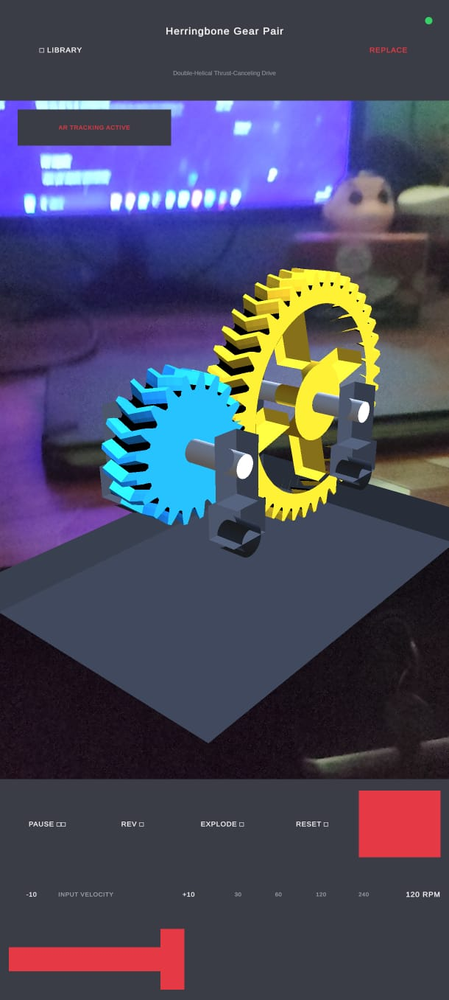
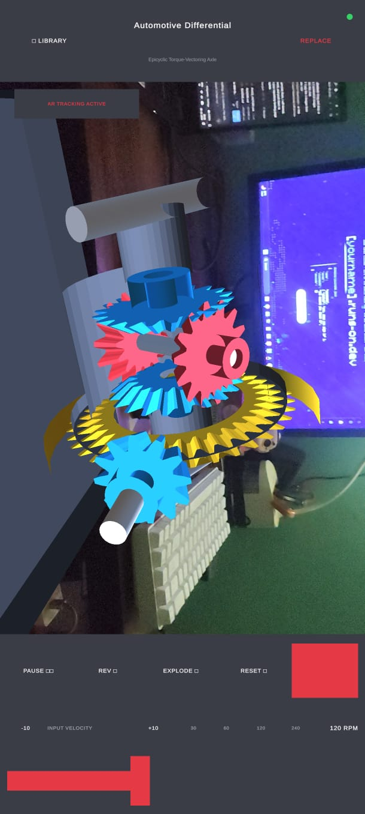
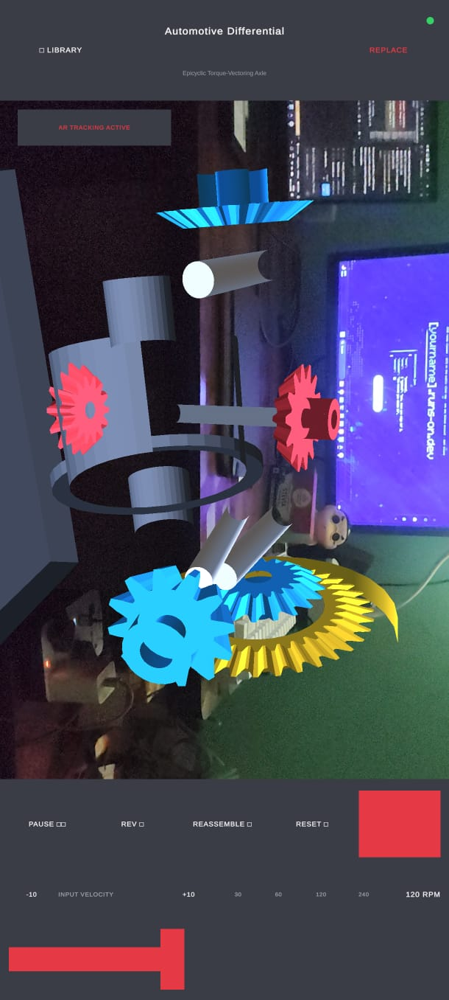
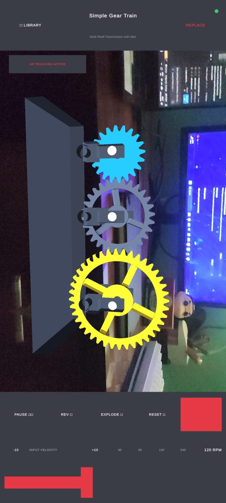
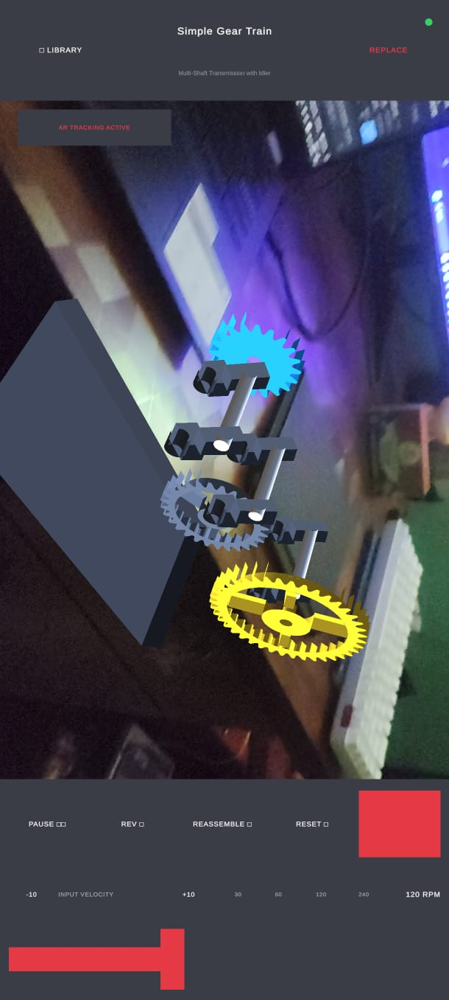
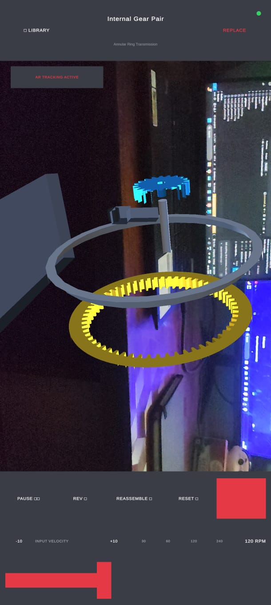

# MECH-XR — Application Visuals & Screen Gallery

This directory houses high-resolution captures of the **MECH-XR** Augmented Reality mobile interface and interactive 3D simulations running live on an Android device (Xiaomi POCO X6 5G).

---

## In-App Screen Gallery

| Preview | Filename | Mechanism & View Mode | Technical Details |
| :---: | :--- | :--- | :--- |
|  | **`01_ar_herringbone_gears.png`** | **Herringbone Gear Pair**<br/>*(Assembled AR Kinematics)* | Double-helical thrust-canceling gear teeth generated procedurally with mounting stanchions, baseplate, and 120 RPM velocity HUD. |
|  | **`02_ar_automotive_differential.png`** | **Automotive Differential**<br/>*(Assembled AR Assembly)* | Epicyclic torque-vectoring axle featuring ring crown gear, drive pinion, dual spider bevel pinions, and side gears. |
|  | **`03_ar_exploded_differential.png`** | **Automotive Differential**<br/>*(Exploded View Inspection)* | Simultaneous component separation along calculated translation vectors showing internal bevel mesh and axle alignment. |
|  | **`04_ar_simple_gear_train.png`** | **Simple Gear Train**<br/>*(Assembled AR Kinematics)* | Three-shaft gear transmission featuring driver, idler, and driven spur gears rotating with active AR plane tracking. |
|  | **`05_ar_exploded_gear_train.png`** | **Simple Gear Train**<br/>*(Exploded View Inspection)* | Forward axial displacement of gears and mounting collars for individual tooth inspection and clearance verification. |
|  | **`06_ar_internal_gear_pair.png`** | **Internal Gear Pair**<br/>*(Exploded View Inspection)* | Annular internal ring gear and spur pinion detached along axis showing internal tooth profile and carrier ring. |

---

## Capturing Future Visuals

### Option 1: Physical Device Shortcut
- Press **Power + Volume Down** simultaneously on your Android device.
- Transfer captures from your device's `Pictures/Screenshots/` directory to `Screenshots/`.

### Option 2: Android Debug Bridge (ADB)
With your Android smartphone connected via USB with **USB Debugging** enabled:

```bash
# Capture full-resolution screen
adb shell screencap -p /sdcard/mechxr_capture.png

# Pull image to Screenshots directory
adb pull /sdcard/mechxr_capture.png Screenshots/

# Remove temporary file from device
adb shell rm /sdcard/mechxr_capture.png
```


